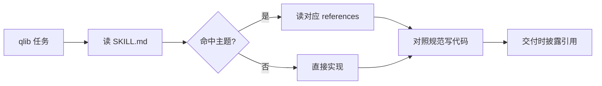

# qlib skill

给 AI 编程智能体使用的 [qlib](https://github.com/microsoft/qlib) 量化框架架构规范技能包。解决智能体反复遗忘 qlib 分层边界、表达式语法、工作流配置等问题。

设计参考 Chrome 官方 [modern-web-guidance](https://github.com/GoogleChrome/modern-web-guidance)：常驻一份 SKILL.md 固化铁律，细则按主题拆分到 references 按需读取，交付时强制披露引用。qlib 知识量小且稳定，不引入向量检索。

## 目录结构

```text
qlib/
├── SKILL.md                    技能入口：六层铁律、触发边界
└── references/
    ├── 01-architecture.md      六层分层、跨层铁律、数据流向
    ├── 02-expression.md        表达式语法、算子清单、常见坑
    ├── 03-data-provider.md     Provider、存储格式、DataHandler 语义
    ├── 04-workflow.md          qrun、yaml 配置、占位符
    ├── 05-backtest-evaluate.md backtest、PortfolioMetrics、risk_analysis
    ├── 06-recorder.md          R 对象、record 模板、产物加载
    ├── 07-antipatterns.md      16 条反模式对照表
    ├── 08-version-compat.md    0.9 系列变更与迁移要点
    └── 09-samples.md           官方 examples 目录地图与代码模板
```

## 安装

### 方式一：skills CLI（推荐，支持多智能体）

```bash
# TRAE 国内版，全局安装
npx skills add <你的GitHub用户名>/qlib-skill --skill qlib --agent trae-cn -g -y --copy

# Claude Code
npx skills add <你的GitHub用户名>/qlib-skill --skill qlib --agent claude-code -g -y --copy
```

安装器交互式选择智能体：

```bash
npx skills add <你的GitHub用户名>/qlib-skill --choose
```

### 方式二：手动复制

将 `SKILL.md` 与 `references/` 复制到目标智能体的用户级 skills 目录：

| 智能体 | 目录 |
|--------|------|
| TRAE 国内版 | `~/skills/qlib/` |
| Claude Code | `~/.claude/skills/qlib/` |
| Gemini CLI | `~/.gemini/skills/qlib/` |

## 工作流



## 覆盖范围

- 数据层、模型层、策略层、执行层、记录层、评估层全链路
- qrun yaml 配置与代码式（workflow_by_code）两种工作流
- 官方 examples 24 个目录的索引与最小模板
- 嵌套执行器（多频率回测）、组合优化、滚动/在线训练等进阶入口
- 16 条高频反模式，每条附源码或文档出处

## 版本对齐

- 知识基于 qlib main 分支与 pyqlib 0.9.x 系列
- 0.9.8 有破坏性安全变更（受限表达式解析器、`trusted=True`），升级前见 `08-version-compat.md`
- sample 路径可能随版本变动，使用前核对你安装的 qlib revision

## 免责声明

本项目为社区技能包，与 Microsoft qlib 官方无关。规范出处均指向官方源码与文档，如内容过时以官方为准。
