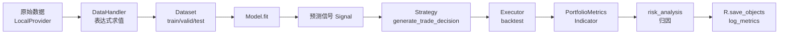

# 01. 分层架构详解

## 官方四层与包结构对应

官方文档分四层：Infrastructure、Learning Framework、Workflow、Interface。按包结构对应六层：

| 官方层 | 包层 | 职责 | 关键类 | 源码路径 |
|---|---|---|---|---|
| Infrastructure | 数据层 | 原始数据存取与表达式计算 | `LocalProvider`、`ExpressionProvider`、`Expression`、`Feature`、`DataHandler` | `qlib/data/data.py:1195`、`qlib/data/base.py:13,238`、`qlib/data/dataset/handler.py:67` |
| Learning Framework | 模型层 | 训练与预测 | `Model.fit/predict`、`ModelFT.finetune` | `qlib/model/base.py:25,63`、`base.py:81` |
| Learning Framework | 策略层 | 信号转为交易决策 | `BaseStrategy.generate_trade_decision`、`BaseSignalStrategy`、`TopkDropoutStrategy`、`WeightStrategyBase` | `qlib/strategy/base.py:23`、`qlib/contrib/strategy/signal_strategy.py:24,74,297` |
| Learning Framework | 执行层 | 撮合与账户 | `BaseExecutor`、`NestedExecutor`、`SimulatorExecutor`、`backtest()`、`Exchange` | `qlib/backtest/executor.py:310,513`、`qlib/backtest/__init__.py:217`、`qlib/backtest/exchange.py:38` |
| Workflow | 记录层 | 实验跟踪 | `QlibRecorder`、`Experiment`、`Recorder` | `qlib/workflow/__init__.py:27`、`qlib/workflow/exp.py:15`、`qlib/workflow/recorder.py:34` |
| Workflow | 评估层 | 报告与指标 | `PortfolioMetrics`、`Indicator`、`risk_analysis` | `qlib/backtest/report.py:22,249`、`qlib/contrib/evaluate.py:26` |

## 跨层铁律（源码证据）

1. **数据流向单向**：`Dataset → Model.fit(dataset)`。证据：`qlib/model/trainer.py:53-57`。
2. **策略不取数**：预测经 `Signal` 对象注入。证据：`signal_strategy.py:63` 的 `create_signal_from`。
3. **占位符解耦**：`<MODEL>`/`<DATASET>` 由训练器填充。证据：`trainer.py:63` 的 `fill_placeholder`。
4. **组件松耦合**：可单独使用。证据：`docs/component/workflow.rst:11`。
5. **嵌套执行时**：外层策略只见外层执行器。证据：`docs/introduction/introduction.rst:56-60`。

## 数据流向图

**铁律**：箭头单向。禁止 Model 直接读 Provider，禁止 Strategy 直接调 `D.features`。
